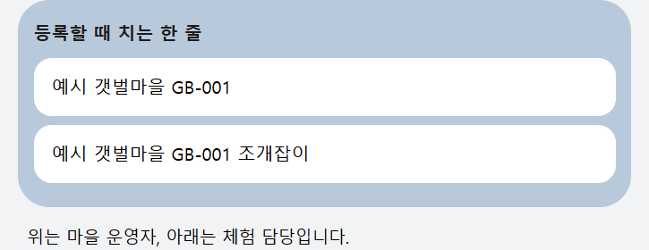

# 등록 메뉴얼

카카오톡에서 채널 `체험마을AI사무장`을 엽니다.

마을 이름과 코드는 버튼이 아닙니다. 한 줄을 칩니다.

마을 운영자는 `마을명 코드`입니다.

`예시 갯벌마을 GB-001`

체험 담당은 그 줄 끝에 체험 이름을 붙입니다.

`예시 갯벌마을 GB-001 조개잡이`

마을 운영자가 먼저 있어야 합니다.

같은 체험을 다시 말하면 거절됩니다.

`이 체험에는 이미 담당자가 있습니다.`

등록이 끝나면 답장 아래에 자기 역할의 버튼이 나옵니다. 그다음은 [사용 메뉴얼](카카오_사용_메뉴얼.md)을 봅니다.

마을 이름, 체험 이름, 등록 코드는 웹 안내에서 확인합니다. 등록 코드는 관리자가 정한 비밀번호 뒤에만 보입니다. 문장 옆의 복사를 누르면 그 문장을 대화에 붙여 넣을 수 있습니다.

https://chonmuseojang.vercel.app/guide/register

운영자로 등록된 뒤 답장 아래의 등록 안내를 누르면 같은 페이지가 열립니다. 관광객 답장에는 이 버튼을 넣지 않습니다. 등록이 거절되거나 코드가 필요할 때는 그 답장에 등록 안내 열기가 붙습니다.
