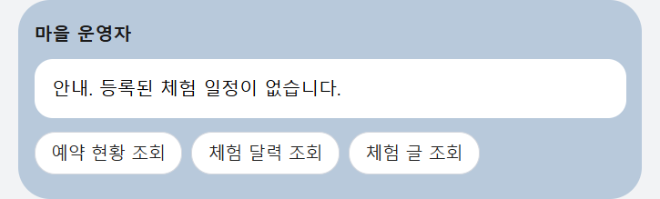
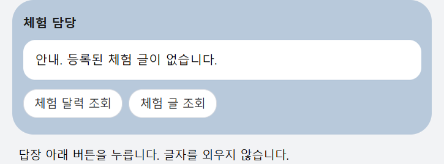

# 사용 메뉴얼

카카오톡에서 채널 `체험마을AI사무장`을 엽니다.

등록이 끝나면 답장 아래에 버튼이 나옵니다. 그 버튼을 누릅니다. 등록 안내와 사용 안내는 운영자만 봅니다.

사용 방법은 웹에서도 봅니다.

https://chonmuseojang.vercel.app/guide/use

## 마을 운영자

버튼은 네 개입니다.

- 예약 현황 조회
- 체험 달력 조회
- 체험 글 조회
- 홍보 사진

홍보 사진을 누른 뒤 사진 한 장을 올립니다.

## 체험 담당

버튼은 세 개입니다.

- 체험 달력 조회
- 체험 글 조회
- 체험 글 저장

체험 글 저장을 누른 뒤 `체험 글` 다음에 내용을 말합니다.

## 예약 현황

`예약 현황 조회`는 이번 주 방문 예약을 답장으로 보여 줍니다. 답장의 `이전 주`, `이번 주`, `다음 주`로 이동합니다. `이전 주`를 다시 누르면 한 주 더 돌아갑니다. 한 주는 일요일부터 토요일까지입니다. 단체 이름이 있는 예약은 그 이름도 한 줄에 나옵니다.

## 달력

`체험 달력 조회` 답장의 **달력 열기**를 누릅니다. 달력과 그 달의 대기, 승인, 거절을 봅니다. 다른 달 대기는 이전달이나 다음달로 이동해 승인하거나 거절합니다. 예약에 단체 이름이 있으면 그 이름도 함께 보입니다.

관광객은 `예약하기`의 **달력으로 예약**을 누릅니다. 그 마을 체험, 단체 이름, 날짜, 시간, 인원을 고릅니다. 문장으로도 예약할 수 있습니다. `조개잡이 2026-11-01 10:00 30명`. 예약 답의 상태 링크에서 대기, 승인, 거절을 확인합니다. 승인과 거절은 마을 운영자만 누릅니다. 체험 담당은 자기 체험 예약만 봅니다.

개인정보 안내는 https://chonmuseojang.vercel.app/privacy 입니다.
