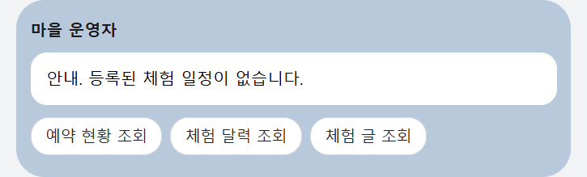
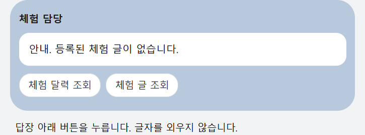

# 사용 메뉴얼

카카오톡에서 채널 `체험마을AI사무장`을 엽니다.

등록이 끝나면 답장 아래에 버튼이 나옵니다. 그 버튼을 누릅니다. 등록 안내와 사용 안내는 운영자만 봅니다.

사용 방법은 웹에서도 봅니다.

https://chonmuseojang.vercel.app/guide/use

## 마을 운영자

버튼은 네 개입니다.

- 예약 현황 조회
- 체험 달력 조회
- 체험 글 조회
- 홍보 사진

홍보 사진을 누른 뒤 사진 한 장을 올립니다.

## 체험 담당

버튼은 세 개입니다.

- 체험 달력 조회
- 체험 글 조회
- 체험 글 저장

체험 글 저장을 누른 뒤 `체험 글` 다음에 내용을 말합니다.

## 달력을 넣을 때

`체험 달력 조회` 답장의 **달력 열기**를 누릅니다. 큰 달력에서 날짜를 누르고 단체 이름과 인원을 저장합니다.

한 줄로 넣을 수도 있습니다.

`조개잡이 2026-11-01 광주소등학교 30명`

체험 이름, 날짜, 단체 이름, 인원입니다.

관광객이 `조개잡이 2026-11-01 30명`처럼 체험 이름을 말해 예약하면, 그 날짜에 `예약번호 대기`로 보입니다. 승인과 거절은 마을 운영자만 누릅니다. 체험 담당은 자기 체험 예약만 봅니다.
